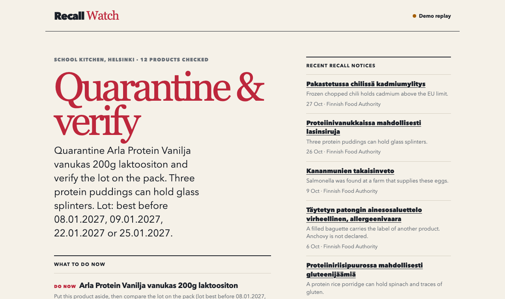

# Recall Watch

Our entry to "The Web Is Your Real-Time Database" by Context.dev. Read `HANDBOOK.md` for the full explanation.

## In brief

A screen in a professional kitchen answers one question: is anything on my shelf recalled right now?

A recall is a public notice that a food product must leave the market. The Finnish Food Authority lists these notices on a web page, as free text in Finnish. Context.dev finds the notices and reads their fields. Plain code compares each notice with the products on the shelf and decides the answer.

The screen has three levels:

| Level | The screen says | When |
|---|---|---|
| 0 | Clear | No open notice names a product on the shelf |
| 1 | Check | A notice names the same brand and name, but another pack or code |
| 2 | Quarantine and verify | An official notice names a product on the shelf |

## What it looks like



The picture shows the demo replay of real notices from 2026. The shelf is our example of a school kitchen with 12 products.

## Run it

Run every command from `recall-watch/`. You need `uv`.

With no key, the screen replays the notices of 2026 from `fixtures/notices-2026.json`:

```
uv run uvicorn recall.app:app --host 0.0.0.0 --port 8030
```

Open `http://localhost:8030/`. For live data, copy `.env.example` to `.env` and put the Context.dev key in it. Run the tests with `uv run pytest`.

## What is true today

1. All 31 tests pass.
2. A code review on 14 November found nine faults. Three of them let an order through for a product under an open recall. All nine are fixed, and a test covers each one.
3. `GET /blocked` and `POST /orders/check` agree: both hold a product that the screen quarantines.
4. The backend never ran against the live API. The limits are in `HANDBOOK.md`, under "Limits to say out loud".
