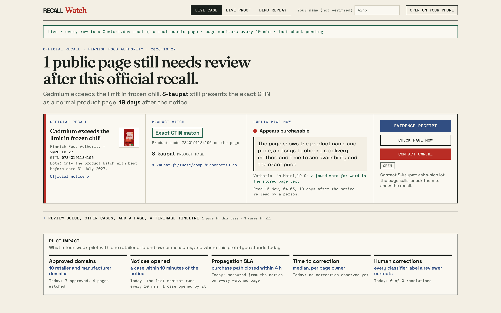
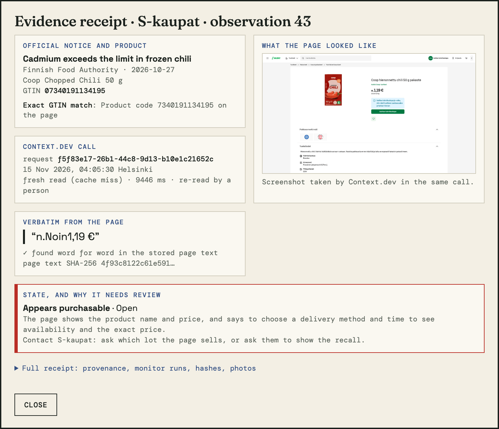

# Recall Watch

**A food recall was published. Eighteen days later, the official shop still sold the exact product.** Recall Watch finds the public pages that have not caught up with an official recall, and gives the responsible person the evidence to act.



## For the judges, in one minute

| | |
|---|---|
| Challenge | Context.dev, "The Web Is Your Real-Time Database", Junction 2026 |
| User | The recall or compliance lead at a retailer, a brand owner or a marketplace |
| Problem | The Finnish Food Authority publishes recalls as free text. Shops and brand pages update late or never, and nobody watches them |
| What it does | Context.dev reads each official notice, monitors the approved shop and brand pages every 10 minutes, and re-reads a page when it changes. Recall Watch shows only the pages that need a decision, with a receipt for each |
| Why trust it | The product match comes from code (the official GTIN on the page), never from a model. A model only describes what the page shows, and a reviewer can correct it. Every receipt carries the Context.dev request id, the time, the words found on the page and a screenshot. Recall Watch drafts the message to the shop owner, and a person sends it |
| What is real | Real notices and real shop pages: the case on the screen is a real recall and a real product page. A live proof on a test page we own shows the whole chain in under a minute. 97 tests, with a fake Context.dev client, so they spend no credits |
| What it is not | Proof that recalled food was sold. "Appears purchasable" means the page showed normal purchase words. The next step asks the owner which lot the page sells |

## Try it

```sh
uv run uvicorn recall.app:app --port 8030
```

Open http://localhost:8030. With `CONTEXT_DEV_API_KEY` in `.env` it reads pages live. Without a key it shows stored evidence, read only. `uv run pytest` runs the 97 tests.

The live proof needs a one-time setup on the demo machine: `uv run python -m recall.proof setup` publishes the test page as a public GitHub gist and creates its Context.dev monitor.

## How it works

1. **Notice:** Context.dev watches the Finnish Food Authority's recall list and reads each new notice into fields: product, GTIN, lots, reason.
2. **Pages:** for each notice, Context.dev monitors the approved shop and manufacturer pages that sell the product.
3. **Match:** code compares the official GTIN with the page, its address and its EAN. Only an exact GTIN is a match.
4. **Change:** when a monitor reports a change, Recall Watch reads the page again and stores a new receipt.
5. **Decision:** the screen shows the pages that still need review. "Contact owner" drafts a message with the notice, the GTIN, the lot and the evidence. Each decision and correction is counted, and the audit trail downloads as CSV.



## Limits we state

1. We started watching 18 to 20 days after these notices, so the screen says "still appears purchasable N days after the notice". It never claims how long a page took to update. A pilot that watches from the first hour measures that.
2. Seven domains are approved today. A pilot runs on 10 retailer and manufacturer domains and measures a 4-hour target for each page.

## More

| Document | For |
|---|---|
| [PITCH.md](PITCH.md) | The spoken pitch, the two-minute demo script and the answers to likely questions |
| [HANDBOOK.md](HANDBOOK.md) | The loop, the review process and the guard rails |
| [WINNING_LOOP.md](WINNING_LOOP.md) | The Context.dev loop and the current evidence |
| [docs/KITCHEN_PROTOTYPE.md](docs/KITCHEN_PROTOTYPE.md) | The earlier kitchen shelf screen, whose code and tests are still here |
| `docs/decks/` | The pitch deck |

Built by team Kindergarten Engineering at Junction 2026.
