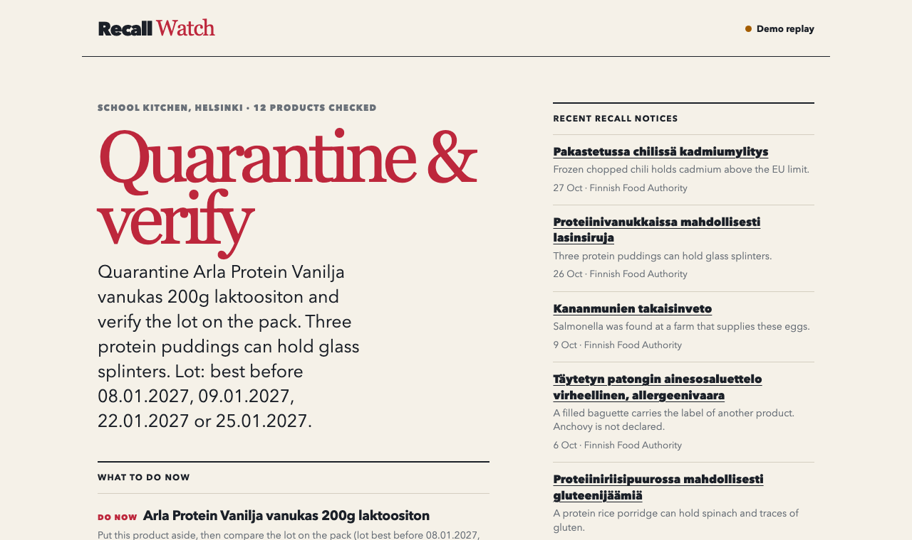

# The earlier kitchen prototype

Recall Watch started as a kitchen shelf screen. Its code and tests stay in the repository.

The picture shows the earlier kitchen shelf prototype, in the demo replay of real notices from 2026. The shelf is our example of a school kitchen with 12 products. Its code is still in the folder (`recall/engine.py`, `recall/replay.py`, the `shelf` list in `watch.yaml`). Its routes stay for its regression tests. They are hidden from the API schema, and its poller runs only with `KITCHEN=1`.

It has three levels:

| Level | The screen says | When |
|---|---|---|
| 0 | Clear | No open notice names a product on the shelf |
| 1 | Check | A notice names the same brand and name, or a similar name |
| 2 | Quarantine and verify | An official notice has the same EAN code as a product on the shelf |

